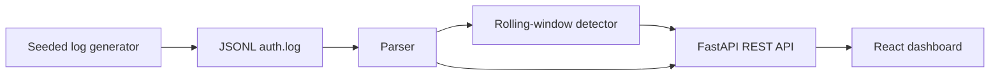

# Security Log Detector

A beginner-friendly, rule-based security monitoring prototype. It parses a reproducible synthetic authentication and request dataset, identifies three suspicious patterns, exposes the results through FastAPI, and presents them in a React dashboard.

> This project uses synthetic data and fixed rules. It is not production-grade security software and does not claim machine learning, real-time monitoring, or real traffic analysis.

## Features

- Seeded JSON Lines generator with more than 300 routine events plus brute-force, suspicious-success, and request-burst scenarios. Addresses are drawn from documentation-reserved ranges.
- Separate parser with safe malformed-line handling and a malformed record count.
- Chronological rolling-window detector with configurable thresholds and per-IP/per-rule alert de-duplication.
- FastAPI endpoints for health, alerts, statistics, paginated events, and IP summaries.
- Responsive React dashboard with Recharts visualizations, filtering, search, and event pagination.

## Detection rules

| Rule | Trigger | Severity |
| --- | --- | --- |
| Brute-force login | At least 5 failed logins from one IP in a rolling 2-minute window | HIGH |
| Suspicious successful login | A successful login from an IP with at least 5 failures in the preceding 2 minutes | CRITICAL |
| Request burst | At least 100 requests from one IP in a rolling 60-second window | MEDIUM |

Each rule emits one alert per IP per analysis run. Rules and thresholds are implemented in `backend/detector.py`.

## Architecture



The API reads and analyzes the small sample file per request. This keeps the prototype easy to understand and avoids a database or background worker.

## Stack and structure

- Backend: Python 3.11+, FastAPI, Uvicorn, pytest
- Frontend: React, Vite, JavaScript, Recharts, Lucide React

```text
backend/   parser, generator, detector, API, sample log, tests
frontend/  Vite application and dashboard components
README.md
```

## Run locally

Open two terminals from the project root.

### Backend

```powershell
cd backend
python -m venv .venv
.venv\Scripts\Activate.ps1
python -m pip install -r requirements.txt
python generate_logs.py --output auth.log --seed 42
uvicorn main:app --reload
```

The API is available at <http://localhost:8000>; interactive API docs are at <http://localhost:8000/docs>.

### Frontend

```powershell
cd frontend
npm install
npm run dev
```

Open <http://localhost:5173>. The frontend expects the API at `http://localhost:8000`; set `VITE_API_URL` in a frontend `.env` file to override it. If the API is offline, the dashboard shows a connection message with a retry action.

## API reference

| Method and path | Description |
| --- | --- |
| `GET /` | Service name, status message, and docs path |
| `GET /health` | Health status |
| `GET /alerts?severity=critical` | All detections, optionally filtered by severity |
| `GET /stats` | Event totals, alert severity counts, IP and login counts, malformed line count |
| `GET /logs?limit=100&offset=0&event_type=request&ip=203.0.113.77` | Filtered, paginated events (`limit` max 1000) |
| `GET /ips` | Per-IP event totals, alert count, and risk level |

## Tests

```powershell
cd backend
python -m pytest -v
```

The tests cover parser edge cases, rolling-window boundaries and de-duplication, IP isolation, and API response/filter/pagination behavior.

## Example alert

```json
{
  "ip": "198.51.100.23",
  "rule_name": "Brute-force login",
  "severity": "HIGH",
  "timestamp": "2025-01-15T12:25:48+00:00",
  "description": "5 failed logins within 120 seconds."
}
```

## Screenshot

No screenshot is included yet; this section is intentionally left without a fabricated image.

## Possible next steps

- Add configurable rules from a small settings file.
- Stream incremental events instead of re-reading a file for each request.
- Add authentication, retention controls, and operational hardening before any real deployment.
- Add exportable alert reports and richer time-range controls.
