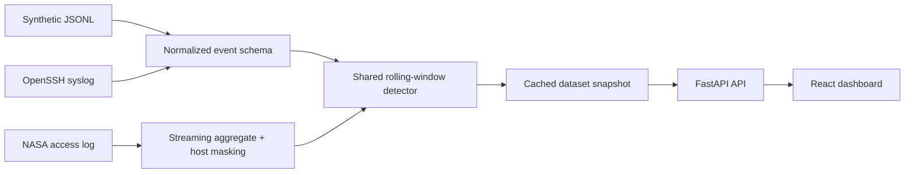

# Security Log Detector

A rule-based log monitoring prototype for authentication activity and aggregate HTTP request patterns. It retains its seeded synthetic logs for deterministic tests and supports importing Loghub OpenSSH and NASA Kennedy Space Center access logs locally.

This is not a production SIEM, does not use machine learning, and does not treat an alert as proof of malicious activity. NASA request bursts are aggregate traffic patterns only. No NASA raw records or raw hostnames are included in the dashboard/API or repository.

## What it does

- Parses JSON Lines synthetic events, yearless OpenSSH syslog messages, and NASA access logs.
- Streams imported files line by line and caches processed aggregates by file size/modification time.
- Applies the same rolling-window detection rules to all normalized sources.
- Reports records processed, valid and malformed rows, date span, event types, and parse duration.
- Offers source selection in the dashboard and `GET /datasets`, `GET /datasets/stats`, and `POST /datasets/select` APIs.
- Shows severity/activity charts, alert records, and IP/host aggregates. NASA hosts are process-keyed HMAC pseudonyms; request-level records and paths are withheld.

## Architecture



The OpenSSH file is parsed as a stream into rolling counters and a bounded 500-row preview. NASA is parsed as a stream into hourly activity buckets, alert aggregates, and top host summaries; it never retains request paths in the snapshot. The API analyzes a given source on first access and reuses the result until the local input file fingerprint changes.

## Detection rules

| Pattern | Default trigger | Severity |
| --- | --- | --- |
| Repeated authentication failures | 5 failures from one source within 120 seconds | HIGH |
| Successful login after failures | Success after 5 failures from that source within 120 seconds | CRITICAL |
| Request burst | 100 requests from one anonymized host within 60 seconds | MEDIUM |

All thresholds are configurable with `FAILED_LOGIN_THRESHOLD`, `FAILED_LOGIN_WINDOW_SECONDS`, `REQUEST_BURST_THRESHOLD`, and `REQUEST_BURST_WINDOW_SECONDS`. For OpenSSH, `OPENSSH_YEAR` supplies the year missing from syslog timestamps (default `2025`, a display assumption rather than recovered provenance). NASA timestamps retain their source timezone (`-0400`).

The Loghub 2,000-line sample inspected during this upgrade had 498 normalized failed logins and **one** successful login. It produced 7 HIGH brute-force-pattern alerts and zero suspicious-success alerts. The sample therefore demonstrates successes exist, but it did not demonstrate a suspicious successful login. Results can vary with parser/configuration versions and are not claims of confirmed attacks.

## Dataset sources and setup

Raw dataset files are ignored by Git. Install them only on the machine doing analysis. The application displays `not installed` with the expected file names if an input is missing.

### OpenSSH / Loghub

The [Loghub OpenSSH catalog](https://github.com/logpai/loghub#logs-currently-available) reports 655,146 messages across 28.4 days (70.02 MiB raw). The GitHub OpenSSH directory contains a **2,000-line sample** (`OpenSSH_2k.log`), not the full collection. A separate full archive (`SSH.tar.gz`) is linked from [Loghub’s Zenodo record](https://zenodo.org/records/8196385). The [dataset README](https://github.com/logpai/loghub/blob/master/OpenSSH/README.md) describes the 28+ day lab capture.

For the sample, download the repository file or use PowerShell:

```powershell
New-Item -ItemType Directory -Force backend\datasets\openssh | Out-Null
Invoke-WebRequest https://raw.githubusercontent.com/logpai/loghub/master/OpenSSH/OpenSSH_2k.log -OutFile backend\datasets\openssh\OpenSSH_2k.log
```

For the full dataset, obtain `SSH.tar.gz` from Zenodo, extract the OpenSSH raw text file, and set `OPENSSH_LOG_PATH` to that extracted file. For example, if it is `backend\datasets\openssh\SSH.log`:

```powershell
$env:OPENSSH_LOG_PATH = (Resolve-Path backend\datasets\openssh\SSH.log).Path
$env:OPENSSH_YEAR = "2025"
```

Loghub states its datasets are available for research or academic work; consult the [repository terms](https://github.com/logpai/loghub#license), retain the notice with any local copy, and cite Jieming Zhu, Shilin He, Pinjia He, Jinyang Liu, and Michael R. Lyu, [“Loghub: A Large Collection of System Log Datasets for AI-driven Log Analytics” (ISSRE 2023, DOI 10.1109/ISSRE59848.2023.00071)](https://doi.org/10.1109/ISSRE59848.2023.00071) where applicable. The project does not redistribute the archive.

Syslog has no year or timezone. The configured year is used and timestamps are interpreted as UTC for this analysis; set the year appropriate to the source before interpreting date-range fields. Invalid entries are counted and skipped. Intermediate PAM authentication-failure messages are ignored to avoid counting the same attempt again when its terminal failed-password record appears. An `Invalid user` record is counted as a failed attempt, and its matching `Failed password for invalid user` terminal record is ignored.

### NASA KSC HTTP logs

The [official NASA-HTTP archive page](https://ita.ee.lbl.gov/html/contrib/NASA-HTTP.html) describes five columns: host, timestamp, quoted request, status, and response bytes. It states the July trace covers July 1–31 and the August trace covers the remainder through August 31; its distribution section lists the August archive as August 4–31, and notes an access gap during a server shutdown. The page reports 3,461,612 requests and one-second timestamp resolution. These are source-published descriptions, not counts measured from files in this workspace.

Download the two gzip archives from the links on that official page, extract the plain text files, and place them here:

```text
backend/datasets/nasa/NASA_access_log_Jul95
backend/datasets/nasa/NASA_access_log_Aug95
```

The official page says the traces may be freely redistributed, but also requests analysis be limited to general traffic patterns. This project follows the stricter privacy scope: no raw NASA data is committed; the dashboard and API expose only aggregates with HMAC-anonymized host labels. Request details, source hostnames, and raw IPs are never returned. Request bursts are not labeled confirmed attacks. The archive names are `NASA_access_log_Jul95.gz` and `NASA_access_log_Aug95.gz`; use the NASA-HTTP distribution links to obtain them, decompress each, and keep the raw files local.

## Run locally

### Backend

```powershell
cd backend
python -m venv .venv
.venv\Scripts\Activate.ps1
python -m pip install -r requirements.txt
python generate_logs.py --seed 42
```

Start any source (synthetic works without downloads):

```powershell
python main.py --source synthetic
python main.py --source openssh
python main.py --source nasa
```

Run a chosen mode in a separate PowerShell session. Alternatively set `LOG_SOURCE=openssh` or `LOG_SOURCE=nasa` before `uvicorn main:app --reload`. The dashboard also has a source selector and can switch datasets without restarting. API docs are at <http://localhost:8000/docs>.

### Frontend

```powershell
cd frontend
npm install
npm run dev
```

Open <http://localhost:5173>. Set `VITE_API_URL` in `frontend/.env` to use a different backend URL.

## API

| Method and path | Purpose |
| --- | --- |
| `GET /` and `GET /health` | Service and current source status |
| `GET /datasets` | Selected source metadata, availability, counts, date range, duration, and event types |
| `GET /datasets/stats` | Aggregate statistics for selected source |
| `POST /datasets/select` with `{"source":"openssh"}` | Select `synthetic`, `openssh`, or `nasa` |
| `GET /stats` | Compatible event and alert counters |
| `GET /alerts?severity=critical` | Pattern detections (NASA source labels are anonymized) |
| `GET /activity` | Minute buckets for synthetic/OpenSSH; hourly buckets for NASA |
| `GET /ips` | Per-IP summaries or top 500 anonymized NASA host aggregates |
| `GET /logs?limit=100&offset=0` | Synthetic/OpenSSH bounded event preview; NASA request details are withheld |

## Tests and performance

```powershell
cd backend
python -m pytest -v
```

The tests include the original synthetic/API checks, OpenSSH normalization and year handling, NASA format/time/status/size parsing, shared detections, missing datasets, source selection, and a 5,000-row streaming fixture that rejects whole-file reads. Full external archives are not required by the test suite.

Processing is cached per source and file fingerprint, so API routes do not parse multi-megabyte files independently. The first request after a source/file change performs the streaming scan synchronously; a full NASA import can take time. The dashboard displays processing duration after the scan. Aggregate memory grows with unique source hosts and alert count, while retained event previews are bounded.

## Limitations

- The real NASA files are not installed in this workspace, so no NASA record counts or alerts are reported as measured results.
- The actual Loghub sample has one successful login but no CRITICAL suspicious-success detections under current rules. Do not infer the full archive result from that sample.
- Yearless OpenSSH timestamps require a user-provided year assumption; source timezone is also absent.
- The detector identifies threshold patterns only. It does not establish intent, attribution, or confirmed attacks.
- This is a local rule-based monitoring prototype, not a hardened production SIEM.
